<div align="center">

<picture>
   <source media="(prefers-color-scheme: dark)" srcset="assets/banner-dark.v12.svg">
   <source media="(prefers-color-scheme: light)" srcset="assets/banner-light.v12.svg">
   
</picture>

<a href="https://github.com/JohandryViles">
   
</a>

<a href="https://www.linkedin.com/in/johandry-viles-0595322b4/"></a>
<a href="mailto:johalop858@gmail.com"></a>


<sub><b>EN</b> · <b>ES</b> — every section, both languages / cada sección, en ambos idiomas</sub>

</div>

<br>

```yaml
# ~/.config/johandry.yaml
name:        Johandry Viles
role:        Full Stack Developer        # Desarrollador Full Stack
focus:       [web platforms, cloud, data, mobile]
languages:   [es-EC, en]
principles:
  - readable code over clever code       # código legible > código ingenioso
  - ship small, ship often, measure      # entregas pequeñas, frecuentes, medibles
  - if it isn't tested, it's a rumor     # si no tiene tests, es un rumor
status:      compiling ideas → shipping code  # compilando ideas → entregando código
coffee:      required                    # dependencia no negociable
```

## `$ cat README --about`

**EN** — I build software end to end: interface, API, database and the infrastructure it runs on.
I care less about how many frameworks I can list and more about whether the thing still works
on a Friday at 6 p.m. after a deploy. This profile used to be a wall of badges; now it's a statement
of intent: fewer toys, more engineering.

**ES** — Construyo software de punta a punta: interfaz, API, base de datos y la infraestructura donde corre.
Me importa menos cuántos frameworks puedo listar y más que todo siga funcionando un viernes
a las 6 p.m. después de un deploy. Antes este perfil era un muro de badges; ahora es una declaración
de intenciones: menos juguetes, más ingeniería.

## `$ ls ./stack`

| Layer · Capa | Tools · Herramientas |
| :--- | :--- |
| **Languages · Lenguajes** |      |
| **Frontend** |      |
| **Backend** |   |
| **Data · Datos** |    |
| **Cloud & Ops** |      |
| **Workflow · Flujo** |     |

<sub>EN: Listed means used in real work, not "watched a 10-minute tutorial once". · ES: Si está aquí, lo he usado en trabajo real, no "vi un tutorial de 10 minutos una vez".</sub>

## `$ git log --roadmap`

```diff
+ Deeper backend work: API design, auth, caching, observability
+   Backend a fondo: diseño de APIs, auth, caché, observabilidad
+ Testing as a habit, not an afterthought (unit → integration → e2e)
+   Testing como hábito, no como castigo (unit → integration → e2e)
+ CI/CD pipelines with GitHub Actions and containerized deploys
+   Pipelines CI/CD con GitHub Actions y despliegues en contenedores
- Starting side projects and abandoning them at 80%
-   Empezar proyectos personales y abandonarlos al 80%
```

## `$ ./engineering-principles.sh`

1. **Make it work, make it right, make it fast.** In that order. Always.<br><sub>Que funcione, que esté bien hecho, que sea rápido. En ese orden. Siempre.</sub>
2. **Names are documentation.** If a function needs a comment to explain what it does, it needs a better name.<br><sub>Los nombres son documentación: si una función necesita un comentario para explicar qué hace, necesita otro nombre.</sub>
3. **Small PRs.** Nobody reviews 2,000 lines carefully; they just approve them.<br><sub>PRs pequeños: nadie revisa 2.000 líneas con cuidado, solo las aprueba.</sub>
4. **Production is the only environment that tells the truth.** Plan accordingly.<br><sub>Producción es el único entorno que dice la verdad. Planifica en consecuencia.</sub>

## `$ gh stats`

<p align="center">
   
   
</p>

<br>

<div align="center">
<sub><code>exit 0</code> &nbsp;·&nbsp; process finished without errors (this time) · proceso terminado sin errores (esta vez)</sub>
</div>
